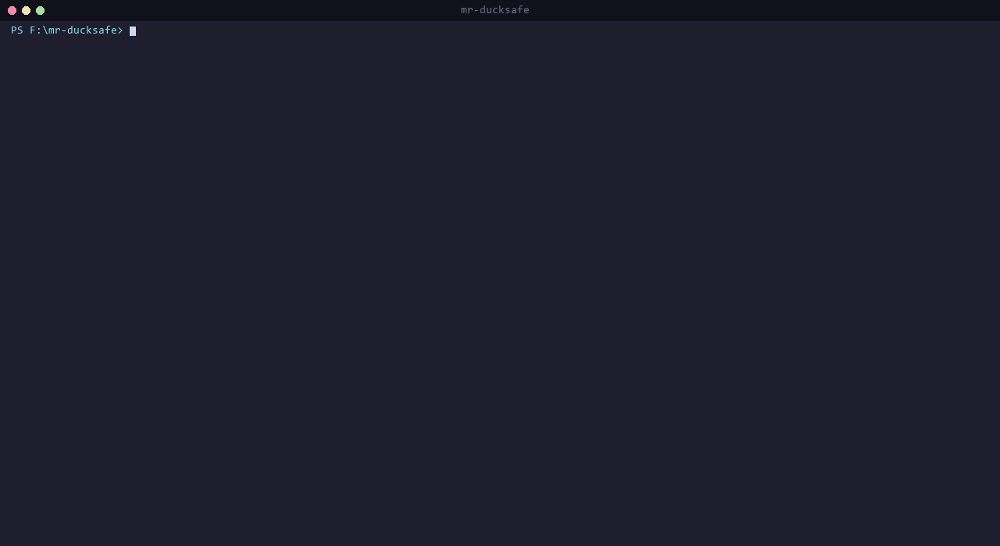
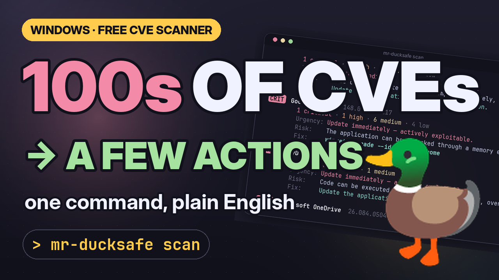

<div align="center">

# 🦆 mr-ducksafe

**NVD CVE scanner for Windows-installed software — single binary, straight from the terminal.**

Not 500+ CVEs → ~10 action items. Risk in plain language, fix in one command.

**🇬🇧 English** · [🇹🇷 Türkçe](README.tr.md) · [🌐 Website](https://ducksafe.yesoftware.dev)

[](https://github.com/yemresalcan/mr-ducksafe/actions/workflows/ci.yml)
[](https://github.com/yemresalcan/mr-ducksafe/actions/workflows/release.yml)
[](https://codecov.io/gh/yemresalcan/mr-ducksafe)
[](https://go.dev/)
[]()
[](LICENSE)
[](https://nvd.nist.gov/)

<br>



</div>

---

## 🎬 Promo Video

<!-- After uploading to YouTube, replace the links below with the video URLs. -->
<a href="docs/media/mr-ducksafe-youtube.mp4"></a>

- ▶️ **YouTube (1:58):** [docs/media/mr-ducksafe-youtube.mp4](docs/media/mr-ducksafe-youtube.mp4) — the problem, how it works, live demo, CI usage, privacy
- 📱 **Shorts (0:37, vertical):** [docs/media/mr-ducksafe-short.mp4](docs/media/mr-ducksafe-short.mp4)

Both videos are narrated in English. They and the thumbnail are generated in code from the scan output in `scripts/demo/` — see [Regenerating the promo material](#regenerating-the-promo-material).

---

## Why?

The Adobe Acrobat, Chrome, Office, Java... on your machine — their **old versions** carry serious security vulnerabilities. Nobody wants to track them manually. `mr-ducksafe` automates exactly that:

- 🔍 **Single `.exe`** — no install, no runtime, no account
- 🌐 **The right data source:** [NVD CVE API 2.0](https://nvd.nist.gov/) (official, CPE-based, ideal for desktop)
- 📊 **Guided summary:** grouped per application, sorted by severity
- 🧠 **Risk in plain language:** not "Use-after-free in XSLT" → "the application can be hijacked through a memory error"
- 🛠️ **Action-oriented:** a `winget upgrade` or update link for every finding
- 🗂️ **Local history:** every scan is written to SQLite, accessed with `history`
- ⚙️ **CI-friendly:** `--format=json`, `--output FILE`, `--fail-on=high`, `NO_COLOR` support
- 🔒 **Privacy:** scanning is fully local; only anonymous `{vendor, product, version}` goes to NVD

**Platform:** Windows. Linux/macOS planned for v0.2.

---

## How It Works

```
 1. Scan             2. Match              3. Query                 4. Explain
 Windows Registry → 50 curated mappings → NVD CVE API 2.0       → plain-language risk
 (installed apps)     name → CPE            (CPE + version range)    + winget / update link
   143 apps             21 matches          525 CVEs                 14 action items
```

1. **Scan** — name, version and publisher of installed software are read from the `HKLM`/`HKCU` Uninstall keys.
2. **Match** — each program is linked to a **CPE** identifier using the rules (exact name or regex) in [`mappings.yaml`](internal/matcher/data/mappings.yaml). Unmatched programs can be listed with `--show-unmatched`.
3. **Query** — NVD is queried for every matched CPE; each CVE's affected version ranges are compared with the installed version.
4. **Explain** — findings are grouped per application and sorted most-severe first; each group gets an urgency, a plain-language risk and a fix command.

### Speed and rate limits

| | NVD request limit | Typical scan (~20 matches) |
|---|---|---|
| no `NVD_API_KEY` | 5 requests / 30 s (~6 s apart) | ~2 minutes |
| with `NVD_API_KEY` | 50 requests / 30 s (~0.7 s apart) | ~15–20 seconds |

The same `{CPE, version}` query is never sent twice within one scan (in-memory cache).

---

## Installation

### Prebuilt binary (recommended)

Download the archive matching your OS from [GitHub Releases](https://github.com/yemresalcan/mr-ducksafe/releases) and put the `mr-ducksafe.exe` (or `mr-ducksafe`) file on your PATH.

Every release ships with a **SHA256 checksum** and an **SBOM** (`*.sbom.json`, CycloneDX).

### Scoop (Windows)

```powershell
# Direct install via manifest URL (no bucket required):
scoop install https://github.com/yemresalcan/mr-ducksafe/releases/latest/download/mr-ducksafe.json
```

> The Scoop manifest will ship as a release artifact in the next version.

### `go install`

With Go 1.25+ installed, one command:

```sh
go install github.com/yemresalcan/mr-ducksafe/cmd/mr-ducksafe@latest
```

> The binary lands in `%USERPROFILE%\go\bin` (or `$GOPATH/bin`); make sure that folder is on your PATH.

### Build from source

Requires Go 1.25+.

```sh
git clone https://github.com/yemresalcan/mr-ducksafe
cd mr-ducksafe
go build -o mr-ducksafe.exe ./cmd/mr-ducksafe
```

### NVD API key (recommended — 10x faster)

[Get a free key](https://nvd.nist.gov/developers/request-an-api-key), then:

```powershell
setx NVD_API_KEY "<key>"
```
> Open a new terminal. `setx` does not affect the current session.

### Uninstall

Delete `mr-ducksafe.exe` and the `%USERPROFILE%\.mr-ducksafe\` folder that holds scan history. Nothing else is written to the registry or the system.

---

## Quick Usage

```sh
mr-ducksafe scan                       # guided summary
mr-ducksafe scan --details             # full CVE table
mr-ducksafe scan --app "Chrome"        # Chrome only
mr-ducksafe scan -o report.json --format=json  # write to file for CI/scripts
mr-ducksafe scan --fail-on=high        # high+ finding → exit 1 (CI)
mr-ducksafe history                    # past scan records
mr-ducksafe prune --older-than=30d     # delete old records
```

---

## Sample Output

```
mr-ducksafe — 14 applications need updating (521 vulnerabilities)

  CRIT  Google Chrome  148.0.7778.179
          1 critical · 1 high · 6 medium · 4 low
          Urgency: Update immediately — actively exploitable.
          Risk:    The application can be hijacked through a memory error.
          Fix:     winget upgrade --id Google.Chrome

  CRIT  AnyDesk  ad 9.6.1
          3 critical · 6 high · 1 medium
          Urgency: Update immediately — actively exploitable.
          Risk:    Code can be executed on your computer remotely, over the internet.
          Fix:     Update the application to the latest version.

  CRIT  Microsoft OneDrive  26.078.0426.0002
          1 critical · 6 high · 2 medium
          Urgency: Update immediately — actively exploitable.
          Risk:    An attacker can elevate their privileges on the system.
          Fix:     Update the application to the latest version.

  CRIT  Node.js  22.17.0
          1 critical · 3 high · 1 medium
          Urgency: Update immediately — actively exploitable.
          Risk:    Code can be executed on your computer remotely, over the internet.
          Fix:     winget upgrade --id OpenJS.NodeJS

  HIGH  Adobe Acrobat Reader DC - Turkish  20.012.20043
          247 high · 135 medium · 27 low
          Urgency: Update soon — serious risk.
          Risk:    Code can be executed on your computer remotely, over the internet.
          Fix:     winget upgrade --id Adobe.Acrobat.Reader.64-bit

  ...

  Details:  mr-ducksafe scan --details        (full CVE list)
            mr-ducksafe scan --app "<name>"   (single application)
```

> **Most of the 409 vulnerabilities in that old Adobe Acrobat are real** — because it hasn't been updated since its 2020 release. This is exactly what the tool should catch.

---

## Commands

### `scan` — run the scan

```
$ mr-ducksafe scan --help

Scan installed software and produce a CVE report

Flags:
      --app string       only show applications whose name contains this text
      --details          show all CVEs as a table instead of the summary
      --fail-on string   exit 1 when threshold is crossed: critical | high | medium | low
      --format string    output format: table | json | markdown (default "table")
  -o, --output string    write the report to this file (default: stdout)
      --show-unmatched   also show software that could not be matched
```

### `history` — list past scans

```
$ mr-ducksafe history --limit 5

ID  Date                 Status   Time  Findings
12  2026-06-03 14:21:08  success  18s   521
11  2026-06-02 09:14:22  success  21s   519
10  2026-06-01 18:02:11  failed   4s    -
```

### `prune` — delete old records

```sh
mr-ducksafe prune --older-than=30d
```

### `version`

```sh
$ mr-ducksafe version
mr-ducksafe v0.1.0
```

### Global flags

| Flag | Description |
|---|---|
| `--db PATH` | SQLite DB path (default: `~/.mr-ducksafe/mr-ducksafe.db`) |
| `--no-color` | Disable colored output (`NO_COLOR` env is also honored) |
| `--verbose` | Detailed logging |

---

## Exit Codes

| Code | Meaning |
|---|---|
| 0 | Success, `--fail-on` threshold not crossed |
| 1 | Threshold crossed (`--fail-on`) or CLI error |
| 2 | Scan error (NVD unreachable, scanner failed) |

---

## Privacy

- Scanning is fully **local**.
- The only request that goes to NVD: `GET ?virtualMatchString=cpe:2.3:a:vendor:product` (HTTPS).
- It **does not** include machine name, user info, or IP.
- Results live in a local SQLite database at `~/.mr-ducksafe/mr-ducksafe.db`.
- No telemetry whatsoever.

---

## Architecture (overview)

```
cmd/mr-ducksafe ──► internal/cmd (Cobra: scan/history/prune/version)
                         │
                         ▼
                  internal/scanengine ──► orchestration (goroutine + semaphore)
                         │
        ┌────────────────┼────────────────┬────────────────┐
        ▼                ▼                ▼                ▼
   internal/      internal/        internal/        internal/
    scanner        matcher          vuln             store
   (Win Reg)    (50 mappings)     (Client iface)    (SQLite)
                                       ├─ nvd       (~/.mr-ducksafe/...)
                                       └─ osv

                  internal/report  ──► table | json | markdown | summary
                  internal/advice  ──► severity + keyword → risk text
                  internal/tui     ──► banner + spinner
```

**Key principle:** the data source (`vuln.Client`) sits behind an interface. NVD and OSV both implement it, and scanengine doesn't care which one.

---

## Using It in CI/CD

When the `--fail-on` threshold is crossed the process exits with **code 1**, so it turns a pipeline red on its own. Example GitHub Actions workflow (weekly scan on a Windows runner, JSON report kept as an artifact):

```yaml
# .github/workflows/cve-scan.yml
name: cve-scan
on:
  schedule: [{ cron: "0 6 * * 1" }]   # every Monday 06:00 UTC
  workflow_dispatch:
jobs:
  scan:
    runs-on: windows-latest            # or your own self-hosted Windows runner
    steps:
      - uses: actions/setup-go@v5
        with: { go-version: "1.25" }
      - run: go install github.com/yemresalcan/mr-ducksafe/cmd/mr-ducksafe@latest
      - run: mr-ducksafe scan --fail-on=high --format=json -o report.json
        env:
          NVD_API_KEY: ${{ secrets.NVD_API_KEY }}
      - uses: actions/upload-artifact@v4
        if: always()
        with: { name: cve-report, path: report.json }
```

> The real value shows up on self-hosted runners or scheduled tasks (Task Scheduler) that scan **your own machines**; a GitHub-hosted runner only scans its own image.

### JSON output schema

Report produced by `--format=json` (`schemaVersion: "1"`):

```json
{
  "schemaVersion": "1",
  "scanId": 15,
  "startedAt": "2026-06-04T22:56:04+03:00",
  "finishedAt": "2026-06-04T22:56:19+03:00",
  "appsTotal": 143,
  "countsBySeverity": { "critical": 7, "high": 322, "medium": 163, "low": 33 },
  "findings": [
    {
      "appName": "Google Chrome",
      "appVersion": "148.0.7778.217",
      "cveId": "CVE-2013-6647",
      "severity": "critical",
      "summary": "A use-after-free in AnimationController::endAnimationUpdate in Google Chrome ..."
    }
  ],
  "unmatched": [
    { "name": "Some Internal Tool", "version": "1.2.3", "publisher": "Contoso" }
  ]
}
```

- `severity`: `critical` · `high` · `medium` · `low` (· `unknown`)
- `fixedVersion` and `references` appear only when the data source provides them (empty fields are omitted).
- `warnings` appears only on partial failures (e.g. a single NVD request failed).
- `--format=markdown` produces a table ready for a PR comment or wiki page.

---

## Supported Applications (50)

<details>
<summary>Show the list</summary>

| Category | Applications |
|---|---|
| Browsers | Google Chrome · Mozilla Firefox · Microsoft Edge · Opera · Brave · Vivaldi |
| Office, PDF, email | Microsoft Office · Adobe Acrobat Reader · LibreOffice · Thunderbird |
| Developer tools | Python 3 · Node.js · Git · Java (JRE) · Java SE Development Kit · Visual Studio Code · IntelliJ IDEA · PyCharm · GoLand · WebStorm · Docker Desktop · Postman · MySQL Workbench · OpenSSL |
| Communication & cloud | Discord · Slack · Zoom · Microsoft Teams · Microsoft OneDrive |
| Remote access, network, file transfer | TeamViewer · AnyDesk · PuTTY · FileZilla Client · WinSCP · Wireshark · OpenVPN |
| Media & design | VLC media player · OBS Studio · Spotify · Steam · Adobe Photoshop · Adobe Illustrator · Adobe Premiere Pro · GIMP · Inkscape · Blender · Audacity |
| Utilities | 7-Zip · Notepad++ · WinRAR |

Source: [`internal/matcher/data/mappings.yaml`](internal/matcher/data/mappings.yaml). Missing an app? Open a [new mapping](#contributing-adding-a-new-mapping) PR.

</details>

---

## FAQ / Troubleshooting

**The scan is very slow.**
Without `NVD_API_KEY`, NVD allows only 5 requests per 30 seconds. A free key makes it ~10x faster (see [NVD API key](#nvd-api-key-recommended--10x-faster)).

**One of my applications is missing from the report.**
It probably could not be matched. Check with `mr-ducksafe scan --show-unmatched`; if it is listed there, open a mapping PR or a [new mapping issue](.github/ISSUE_TEMPLATE/new_mapping.yml).

**The "Fix" line says "Update the application to the latest version" instead of a `winget` command.**
That application's mapping has no `winget_id` yet. When it does, you can update with one command.

**Some CVEs look very old (2008, 2012...).**
NVD flags these for *all* versions of the CPE (mostly protocol-level issues: TLS, SPDY, etc.). The summary view groups them; `--details` shows the raw list.

**Windows SmartScreen shows a warning.**
Release binaries are not code-signed yet. Verify the archive's SHA256 against `checksums.txt`, then choose "More info → Run anyway".

**`scanner: bu işletim sistemi henüz desteklenmiyor` (OS not supported) on Linux/macOS.**
Linux/macOS binaries are published, but the software scanner currently only reads the Windows Registry. dpkg/rpm/Homebrew support is planned for v0.2.

**I got exit code 2.**
Scan error — usually NVD was unreachable (network, proxy, NVD maintenance). The cause is printed to stderr on the `scan failed: ...` line.

---

## Known Limitations (MVP)

- **50 application mappings** — covers top software; the rest show up as "unmatched". Grows through community PRs.
- **Version schemes vary across applications** — the "Fix" column may stay empty (when NVD uses `versionEndIncluding` — like Adobe).
- **Category-based education only (Level A):** explanations derived from severity + keyword, not per individual CVE. LLM-assisted Level B planned for v0.2.
- **Apps using build numbers** (e.g. older JetBrains) need a `version_from_name` regex added to `mappings.yaml` (example provided).

---

## Development

```sh
go test ./... -race                     # all tests
go test ./... -coverprofile=cover.out   # coverage
golangci-lint run                       # lint

# Local cross-platform release smoke (goreleaser must be installed)
goreleaser release --snapshot --clean

# Manual cross-platform build
.\scripts\build.ps1 -Version "0.1.0"
./scripts/build.sh 0.1.0
```

### Regenerating the promo material

The README thumbnail and the videos under `docs/media/` are generated in code (requires Python 3.10+, Pillow, numpy, ffmpeg):

```sh
python scripts/video/render_video.py                # thumbnail + YouTube + Shorts
python scripts/video/render_video.py thumbnail      # thumbnail only
python scripts/video/render_video.py preview short  # a few preview frames
```

Terminal scenes use English translations (`scripts/demo/en/`) of the real scan output in `scripts/demo/*.txt`; music and sound effects are synthesized with numpy (no licensing issues). Narration runs locally with [Kokoro-82M](https://huggingface.co/hexgrad/Kokoro-82M) (Apache-2.0): `pip install kokoro-onnx`, then download `onnx/model.onnx` and `voices/af_heart.bin` from [onnx-community/Kokoro-82M-v1.0-ONNX](https://huggingface.co/onnx-community/Kokoro-82M-v1.0-ONNX) and point `KOKORO_MODEL` / `KOKORO_VOICES` at them (details at the top of the script). Set `DUCKSAFE_TTS=off` to render without narration. YouTube title/description/chapter text: [docs/media/YOUTUBE.md](docs/media/YOUTUBE.md).

**Documents:**
- Design: [docs/superpowers/specs/2026-05-23-mr-ducksafe-design.md](docs/superpowers/specs/2026-05-23-mr-ducksafe-design.md)
- CLI-only pivot: [docs/superpowers/specs/2026-06-03-cli-only-pivot-design.md](docs/superpowers/specs/2026-06-03-cli-only-pivot-design.md)
- Implementation plan: [docs/superpowers/plans/2026-05-24-mr-ducksafe-mvp.md](docs/superpowers/plans/2026-05-24-mr-ducksafe-mvp.md)

---

## Contributing: Adding a New Mapping

Open a PR against `internal/matcher/data/mappings.yaml`. Each entry:

```yaml
- registry_name: "App Name"          # or registry_name_pattern (regex)
  publisher: "Vendor"
  identifier:
    type: cpe
    value: "cpe:2.3:a:vendor:product"
  version_normalize: "semver"        # semver | fourpart | calver
  version_from_name: "(\\d+\\.\\d+)" # optional — extract version from name
  winget_id: "Vendor.Product"        # optional — remediation command
  update_url: "https://..."          # optional — manual update link
```

Verify CPEs via [nvd.nist.gov/products/cpe/search](https://nvd.nist.gov/products/cpe/search).

Use the [issue templates](.github/ISSUE_TEMPLATE/) to report a bug, request a feature, or suggest a new mapping.

---

## Roadmap

**v0.1 (current MVP)** ✅
- Windows Registry scanner
- NVD CPE + version range matching
- 50 curated mappings
- Guided summary + winget remediation + Level A explanations
- CLI (`scan` / `history` / `prune`), SQLite history, JSON/Markdown output
- Multi-platform release (Windows/Linux/macOS binaries) + SBOM

**v0.2 (planned)**
- Linux scanner (dpkg, rpm, pacman)
- macOS scanner (Homebrew, `/Applications`)
- Mapping list to 200+ (via community PRs)
- `versionEndIncluding` support in the "Fix" column
- Scoop bucket + Homebrew tap

**v0.3+ (ideas)**
- Level B: `--explain` flag + optional LLM for per-CVE explanations
- Browser extension / VS Code extension scanning
- `--auto-fix` (with a liability warning)

---

## License

[MIT](LICENSE) — Copyright (c) 2026 Yunus Emre Salcan

---

<div align="center">

**Finding and fixing vulnerabilities should never have been this simple.** 🦆

</div>
