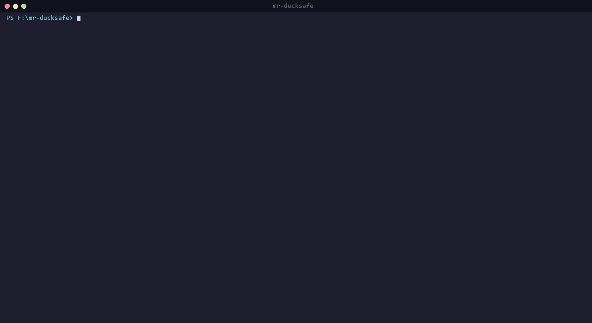
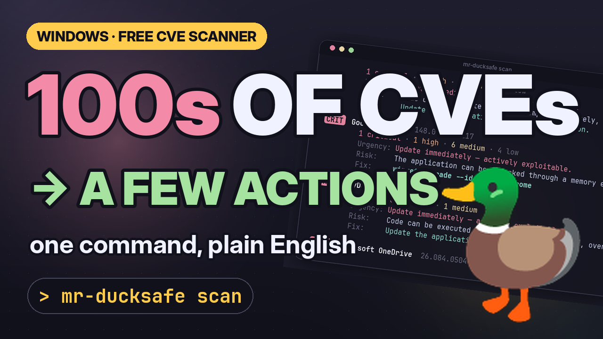

<div align="center">

# 🦆 mr-ducksafe

**Windows kurulu yazılımları için NVD CVE tarayıcı — tek binary, terminalden.**

500+ CVE değil → ~10 aksiyon maddesi. Risk insan dilinde, çözüm tek komut.

[🇬🇧 English](README.md) · **🇹🇷 Türkçe** · [🌐 Web sitesi](https://ducksafe.yesoftware.dev)

[](https://github.com/yemresalcan/mr-ducksafe/actions/workflows/ci.yml)
[](https://github.com/yemresalcan/mr-ducksafe/actions/workflows/release.yml)
[](https://codecov.io/gh/yemresalcan/mr-ducksafe)
[](https://go.dev/)
[]()
[](LICENSE)
[](https://nvd.nist.gov/)

<br>



</div>

---

## 🎬 Tanıtım Videosu

<!-- YouTube'a yükledikten sonra aşağıdaki linkleri video URL'leriyle değiştir. -->
<a href="docs/media/mr-ducksafe-youtube.mp4"></a>

- ▶️ **YouTube (1:58):** [docs/media/mr-ducksafe-youtube.mp4](docs/media/mr-ducksafe-youtube.mp4) — sorun, nasıl çalışır, canlı demo, CI kullanımı, gizlilik
- 📱 **Shorts (0:37, dikey):** [docs/media/mr-ducksafe-short.mp4](docs/media/mr-ducksafe-short.mp4)

Videolar İngilizce seslendirmeli ve İngilizce ekran yazılıdır (terminal sahneleri İngilizce README'deki (`README.md`) gibi İngilizceye çevrilmiş çıktıyı gösterir). Hepsi kodla üretilir — bkz. [Tanıtım materyallerini yeniden üretmek](#tanıtım-materyallerini-yeniden-üretmek).

---

## Neden?

Bilgisayarındaki Adobe Acrobat, Chrome, Office, Java... bunların **eski sürümlerinde** ciddi güvenlik açıkları var. Kimse manuel takip etmek istemez. `mr-ducksafe` bunu otomatikleştirir:

- 🔍 **Tek `.exe`** — kurulum, runtime, hesap yok
- 🌐 **Doğru veri kaynağı:** [NVD CVE API 2.0](https://nvd.nist.gov/) (resmi, CPE tabanlı, masaüstü için ideal)
- 📊 **Rehberli özet:** uygulama bazında gruplu, severity'ye göre sıralı
- 🧠 **İnsan dilinde risk:** "Use-after-free in XSLT" değil → "bellek hatası yoluyla uygulama ele geçirilebilir"
- 🛠️ **Aksiyon odaklı:** her bulgu için `winget upgrade` veya güncelleme linki
- 🗂️ **Lokal geçmiş:** her tarama SQLite'a yazılır, `history` ile erişilir
- ⚙️ **CI dostu:** `--format=json`, `--output FILE`, `--fail-on=high`, `NO_COLOR` desteği
- 🔒 **Gizlilik:** tarama tamamen lokal; sadece anonim `{vendor, product, version}` NVD'ye gider

**Platform:** Windows. Linux/macOS v0.2'de planlanıyor.

---

## Nasıl Çalışır?

```
 1. Tara            2. Eşleştir           3. Sorgula               4. Açıkla
 Windows Registry → 50 hazır mapping   → NVD CVE API 2.0       → sade dilde risk
 (kurulu programlar)  ile ad → CPE        (CPE + sürüm aralığı)    + winget / güncelleme linki
   143 program          21 eşleşme          525 CVE                  14 aksiyon
```

*Sayılar bir geliştirici bilgisayarındaki örnek taramadan; senin sonuçların farklı olacaktır.*

1. **Tara** — `HKLM`/`HKCU` Uninstall anahtarlarından kurulu yazılımların adı, sürümü ve yayıncısı okunur.
2. **Eşleştir** — Her program, [`mappings.yaml`](internal/matcher/data/mappings.yaml) içindeki kurallarla (tam ad veya regex) bir **CPE** kimliğine bağlanır. Eşleşmeyenler `--show-unmatched` ile görülebilir.
3. **Sorgula** — Eşleşen her CPE için NVD'ye istek atılır; CVE'lerin etkilenen sürüm aralıkları kurulu sürümle karşılaştırılır.
4. **Açıkla** — Bulgular uygulama bazında gruplanır, en ciddi olan üstte olacak şekilde sıralanır; her grup için aciliyet, sade dilde risk ve çözüm komutu üretilir.

### Hız ve rate limit

| | İstek limiti (NVD) | Tipik tarama (~20 eşleşme) |
|---|---|---|
| `NVD_API_KEY` yok | 5 istek / 30 sn (~6 sn aralık) | ~2 dakika |
| `NVD_API_KEY` var | 50 istek / 30 sn (~0.7 sn aralık) | ~15–20 saniye |

Aynı `{CPE, sürüm}` sorgusu tek tarama içinde tekrar atılmaz (bellek içi cache).

---

## Kurulum

### Hazır binary (önerilen)

[GitHub Releases](https://github.com/yemresalcan/mr-ducksafe/releases) üzerinden işletim sistemine uygun arşivi indir, `mr-ducksafe.exe` (veya `mr-ducksafe`) dosyasını PATH'e koy.

Her release için **SHA256 checksum** ve **SBOM** (`*.sbom.json`, CycloneDX) yayınlanıyor.

### Scoop (Windows)

```powershell
# Manifest URL ile direkt kurulum (bucket gerekmez):
scoop install https://github.com/yemresalcan/mr-ducksafe/releases/latest/download/mr-ducksafe.json
```

> Scoop manifest sonraki sürümde release artifact'i olarak yayınlanacak.

### `go install`

Go 1.25+ kuruluysa tek komut:

```sh
go install github.com/yemresalcan/mr-ducksafe/cmd/mr-ducksafe@latest
```

> Binary `%USERPROFILE%\go\bin` (veya `$GOPATH/bin`) altına kurulur; bu klasörün PATH'te olduğundan emin ol.

### Kaynaktan build

Go 1.25+ gerekli.

```sh
git clone https://github.com/yemresalcan/mr-ducksafe
cd mr-ducksafe
go build -o mr-ducksafe.exe ./cmd/mr-ducksafe
```

### NVD API key (önerilen — 10x hızlı)

[Ücretsiz key al](https://nvd.nist.gov/developers/request-an-api-key), sonra:

```powershell
setx NVD_API_KEY "<key>"
```
> Yeni terminal aç. `setx` mevcut oturumu etkilemez.

### Kaldırma

`mr-ducksafe.exe` dosyasını ve tarama geçmişinin tutulduğu `%USERPROFILE%\.mr-ducksafe\` klasörünü silmen yeterli. Registry'ye veya sisteme başka bir şey yazılmaz.

---

## Dil (English / Türkçe)

mr-ducksafe bir terminalde ilk kez çalıştığında hangi dili kullanmak istediğini sorar ve cevabı hatırlar. Çıktılar, yardım metinleri ve sade dildeki açıklamalar İngilizce ve Türkçe olarak mevcuttur.

```sh
mr-ducksafe lang          # geçerli dili göster
mr-ducksafe lang en       # İngilizceye geç (kaydedilir)
mr-ducksafe scan --lang tr          # sadece bu çalıştırma için
```

`MR_DUCKSAFE_LANG=en|tr` ortam değişkeni de kayıtlı seçimi geçersiz kılar. CI gibi etkileşimsiz ortamlarda soru sorulmaz, varsayılan İngilizcedir. JSON çıktısı iki dilde de aynıdır.

---

## Hızlı Kullanım

```sh
mr-ducksafe scan                       # rehberli özet
mr-ducksafe scan --details             # tüm CVE tablosu
mr-ducksafe scan --app "Chrome"        # sadece Chrome
mr-ducksafe scan -o report.json --format=json  # CI/script için dosyaya yaz
mr-ducksafe scan --fail-on=high        # high+ bulgu → exit 1 (CI)
mr-ducksafe history                    # geçmiş tarama kayıtları
mr-ducksafe prune --older-than=30d     # eski kayıtları sil
```

---

## Örnek Çıktı

```
mr-ducksafe — güncellenmesi gereken 14 yazılım (521 açık)

  KRIT  Google Chrome  148.0.7778.179
          1 kritik · 1 yüksek · 6 orta · 4 düşük
          Aciliyet: Acilen güncelle — aktif sömürülebilir.
          Risk:     Bellek hatası yoluyla uygulama ele geçirilebilir.
          Çözüm:    winget upgrade --id Google.Chrome

  KRIT  AnyDesk  ad 9.6.1
          3 kritik · 6 yüksek · 1 orta
          Aciliyet: Acilen güncelle — aktif sömürülebilir.
          Risk:     Uzaktan, internet üzerinden bilgisayarınızda kod çalıştırılabilir.
          Çözüm:    Uygulamayı en son sürüme güncelleyin.

  KRIT  Microsoft OneDrive  26.078.0426.0002
          1 kritik · 6 yüksek · 2 orta
          Aciliyet: Acilen güncelle — aktif sömürülebilir.
          Risk:     Saldırgan sistemdeki yetkilerini yükseltebilir.
          Çözüm:    Uygulamayı en son sürüme güncelleyin.

  KRIT  Node.js  22.17.0
          1 kritik · 3 yüksek · 1 orta
          Aciliyet: Acilen güncelle — aktif sömürülebilir.
          Risk:     Uzaktan, internet üzerinden bilgisayarınızda kod çalıştırılabilir.
          Çözüm:    winget upgrade --id OpenJS.NodeJS

  YÜKS  Adobe Acrobat Reader DC - Turkish  20.012.20043
          247 yüksek · 135 orta · 27 düşük
          Aciliyet: Yakında güncelle — ciddi risk.
          Risk:     Uzaktan, internet üzerinden bilgisayarınızda kod çalıştırılabilir.
          Çözüm:    winget upgrade --id Adobe.Acrobat.Reader.64-bit

  ...

  Detay:  mr-ducksafe scan --details        (tüm CVE listesi)
          mr-ducksafe scan --app "<isim>"   (tek uygulama)
```

> **Eski Adobe Acrobat'ın 409 açığının çoğu gerçektir** — 2020 sürümünden beri güncellenmediği için. Araç tam da bunu yakalamalı.

---

## Komutlar

### `scan` — taramayı çalıştır

```
$ mr-ducksafe scan --help

Kurulu yazılımları tarayıp CVE raporu üret

Flags:
      --app string       sadece adı bu metni içeren uygulamayı göster
      --details          özet yerine tüm CVE'leri tablo halinde göster
      --fail-on string   eşik aşıldığında exit 1: critical | high | medium | low
      --format string    çıktı formatı: table | json | markdown (default "table")
  -o, --output string    raporu bu dosyaya yaz (varsayılan: stdout)
      --show-unmatched   eşleştirilemeyen yazılımları da göster
```

### `history` — geçmiş taramaları listele

```
$ mr-ducksafe history --limit 5

ID  Tarih                Durum    Süre  Bulgu
12  2026-06-03 14:21:08  success  18s   521
11  2026-06-02 09:14:22  success  21s   519
10  2026-06-01 18:02:11  failed   4s    -
```

### `prune` — eski kayıtları sil

```sh
mr-ducksafe prune --older-than=30d
```

### `version`

```sh
$ mr-ducksafe version
mr-ducksafe v0.1.0
```

### Global flag'ler

| Flag | Açıklama |
|---|---|
| `--db PATH` | SQLite DB yolu (default: `~/.mr-ducksafe/mr-ducksafe.db`) |
| `--no-color` | Renkli çıktıyı kapat (`NO_COLOR` env de onurlandırılır) |
| `--verbose` | Ayrıntılı log |

---

## Exit Code'ları

| Code | Anlam |
|---|---|
| 0 | Başarılı, `--fail-on` eşiği aşılmadı |
| 1 | Eşik aşıldı (`--fail-on`) veya CLI hatası |
| 2 | Tarama hatası (NVD erişilemedi, scanner başarısız) |

---

## Gizlilik

- Tarama tamamen **lokal**.
- NVD'ye giden tek istek: `GET ?virtualMatchString=cpe:2.3:a:vendor:product` (HTTPS).
- Makine adı, kullanıcı bilgisi, IP **içermez**.
- Sonuçlar `~/.mr-ducksafe/mr-ducksafe.db` içinde lokal SQLite'ta.
- Hiçbir telemetri yok.

---

## Mimari (özet)

```
cmd/mr-ducksafe ──► internal/cmd (Cobra: scan/history/prune/version)
                         │
                         ▼
                  internal/scanengine ──► orkestrasyon (goroutine + semaphore)
                         │
        ┌────────────────┼────────────────┬────────────────┐
        ▼                ▼                ▼                ▼
   internal/      internal/        internal/        internal/
    scanner        matcher          vuln             store
   (Win Reg)    (50 mapping)      (Client iface)    (SQLite)
                                       ├─ nvd       (~/.mr-ducksafe/...)
                                       └─ osv

                  internal/report  ──► table | json | markdown | özet
                  internal/advice  ──► severity + keyword → risk metni
                  internal/tui     ──► banner + spinner
```

**Anahtar prensip:** Veri kaynağı (`vuln.Client`) interface arkasında. NVD ve OSV ikisi de implement eder, scanengine fark etmez.

---

## CI/CD'de Kullanım

`--fail-on` eşiği aşıldığında süreç **exit 1** ile biter; bu yüzden pipeline'ı doğrudan kırmızıya çevirir. Örnek GitHub Actions iş akışı (Windows runner üzerinde haftalık tarama + JSON raporu artifact olarak saklama):

```yaml
# .github/workflows/cve-scan.yml
name: cve-scan
on:
  schedule: [{ cron: "0 6 * * 1" }]   # her pazartesi 06:00 UTC
  workflow_dispatch:
jobs:
  scan:
    runs-on: windows-latest            # veya kendi self-hosted Windows runner'ın
    steps:
      - uses: actions/setup-go@v5
        with: { go-version: "1.25" }
      - run: go install github.com/yemresalcan/mr-ducksafe/cmd/mr-ducksafe@latest
      - run: mr-ducksafe scan --fail-on=high --format=json -o report.json
        env:
          NVD_API_KEY: ${{ secrets.NVD_API_KEY }}
      - uses: actions/upload-artifact@v4
        if: always()
        with: { name: cve-report, path: report.json }
```

> Asıl değer, **kendi makinelerini** tarayan self-hosted runner'larda veya zamanlanmış görevlerde (Task Scheduler) ortaya çıkar; GitHub'ın hazır runner'ı yalnızca kendi imajını tarar.

### JSON çıktı şeması

`--format=json` ile üretilen rapor (`schemaVersion: "1"`):

```json
{
  "schemaVersion": "1",
  "scanId": 15,
  "startedAt": "2026-06-04T22:56:04+03:00",
  "finishedAt": "2026-06-04T22:56:19+03:00",
  "appsTotal": 143,
  "countsBySeverity": { "critical": 7, "high": 322, "medium": 163, "low": 33 },
  "findings": [
    {
      "appName": "Google Chrome",
      "appVersion": "148.0.7778.217",
      "cveId": "CVE-2013-6647",
      "severity": "critical",
      "summary": "A use-after-free in AnimationController::endAnimationUpdate in Google Chrome ..."
    }
  ],
  "unmatched": [
    { "name": "Some Internal Tool", "version": "1.2.3", "publisher": "Contoso" }
  ]
}
```

- `severity`: `critical` · `high` · `medium` · `low` (· `unknown`)
- `fixedVersion` ve `references` yalnızca veri kaynağı bu bilgiyi verdiğinde bulunur (boşsa alan hiç yazılmaz).
- `warnings` yalnızca kısmi hatalarda (örn. tek bir NVD isteği başarısız olduğunda) bulunur.
- `--format=markdown` ise PR yorumu / wiki için hazır bir tablo üretir.

---

## Desteklenen Uygulamalar (50)

<details>
<summary>Listeyi göster</summary>

| Kategori | Uygulamalar |
|---|---|
| Tarayıcılar | Google Chrome · Mozilla Firefox · Microsoft Edge · Opera · Brave · Vivaldi |
| Ofis, PDF, e-posta | Microsoft Office · Adobe Acrobat Reader · LibreOffice · Thunderbird |
| Geliştirici araçları | Python 3 · Node.js · Git · Java (JRE) · Java SE Development Kit · Visual Studio Code · IntelliJ IDEA · PyCharm · GoLand · WebStorm · Docker Desktop · Postman · MySQL Workbench · OpenSSL |
| İletişim ve bulut | Discord · Slack · Zoom · Microsoft Teams · Microsoft OneDrive |
| Uzak erişim, ağ, dosya transferi | TeamViewer · AnyDesk · PuTTY · FileZilla Client · WinSCP · Wireshark · OpenVPN |
| Medya ve tasarım | VLC media player · OBS Studio · Spotify · Steam · Adobe Photoshop · Adobe Illustrator · Adobe Premiere Pro · GIMP · Inkscape · Blender · Audacity |
| Araçlar | 7-Zip · Notepad++ · WinRAR |

Kaynak: [`internal/matcher/data/mappings.yaml`](internal/matcher/data/mappings.yaml). Listede olmayan bir uygulama için [yeni mapping](#katkı-yeni-mapping-eklemek) PR'ı açabilirsin.

</details>

---

## SSS / Sorun Giderme

**Tarama çok yavaş.**
`NVD_API_KEY` tanımlı değilse NVD 30 saniyede yalnızca 5 isteğe izin verir. Ücretsiz key ile ~10 kat hızlanır (bkz. [NVD API key](#nvd-api-key-önerilen--10x-hızlı)).

**Bir uygulamam raporda yok.**
Muhtemelen eşleştirilemedi. `mr-ducksafe scan --show-unmatched` ile kontrol et; listede yoksa bir mapping PR'ı ya da [yeni mapping issue'su](.github/ISSUE_TEMPLATE/new_mapping.yml) aç.

**"Çözüm" satırı "Uygulamayı en son sürüme güncelleyin" diyor, `winget` komutu yok.**
O uygulama için mapping'de `winget_id` tanımlı değil. Tanımlıysa tek komutla güncelleyebilirsin.

**Bazı CVE'ler çok eski görünüyor (2008, 2012...).**
NVD bu kayıtları ilgili CPE'nin *tüm* sürümleri için etkilenmiş olarak işaretliyor (çoğu protokol seviyesi açık: TLS, SPDY vb.). Özet görünüm bunları gruplar; `--details` ham listeyi gösterir.

**`mr-ducksafe.exe`'ye çift tıklayınca bir pencere açılıyor, normal mi?**
Evet. Explorer'dan açıldığında `mr-ducksafe scan` çalıştırır, raporu gösterir ve pencereyi kapatmadan önce Enter'a basmanı bekler. Diğer komutlar ve seçenekler için bir terminal (PowerShell veya cmd) açıp oradan çalıştır.

**Windows SmartScreen uyarı veriyor.**
Release binary'leri henüz kod imzalı değil. İndirdiğin arşivin SHA256 değerini `checksums.txt` ile doğrulayıp "Ek bilgi → Yine de çalıştır" diyebilirsin.

**Linux/macOS'ta `scanner: this operating system is not supported yet` hatası.**
Release'te Linux/macOS binary'leri de var ama yazılım tarayıcısı şu an yalnızca Windows Registry'yi okuyor. dpkg/rpm/Homebrew desteği v0.2'de.

**Exit kodu 2 aldım.**
Tarama hatası: çoğunlukla NVD'ye ulaşılamadı (ağ, proxy, NVD bakımı). Nedeni stderr'de `scan failed: ...` satırında yazar.

---

## Bilinen Sınırlamalar (MVP)

- **50 uygulama mapping'i** — top yazılımları kapsar; geri kalan "eşleştirilemedi" görünür. Topluluk PR'larıyla genişler.
- **Versiyon şeması farklı uygulamalarda** "Düzeltme" sütunu boş kalabilir (NVD `versionEndIncluding` kullandığında — Adobe gibi).
- **Sadece kategori-bazlı öğreticilik (Seviye A):** Her CVE için değil, severity + anahtar kelimeden türeyen açıklamalar. LLM destekli Seviye B v0.2'de planlanıyor.
- **Build numarası kullanan apps** (örn. eski JetBrains) için `version_from_name` regex'i `mappings.yaml`'a eklenmeli (örnek mevcut).

---

## Geliştirme

```sh
go test ./... -race                     # tüm testler
go test ./... -coverprofile=cover.out   # coverage
golangci-lint run                       # lint

# Lokal cross-platform release smoke (goreleaser kurulu olmalı)
goreleaser release --snapshot --clean

# Manuel cross-platform build
.\scripts\build.ps1 -Version "0.1.0"
./scripts/build.sh 0.1.0
```

### Tanıtım materyallerini yeniden üretmek

README'deki thumbnail ve `docs/media/` altındaki videolar kodla üretilir (Python 3.10+, Pillow, numpy, ffmpeg gerekir):

```sh
python scripts/video/render_video.py              # thumbnail + YouTube + Shorts
python scripts/video/render_video.py thumbnail    # sadece thumbnail
python scripts/video/render_video.py preview short  # birkaç kare önizleme
```

Terminal sahneleri gerçek tarama çıktılarının (`scripts/demo/*.txt`) İngilizce karşılıklarından (`scripts/demo/en/`) beslenir; müzik ve efektler numpy ile sentezlenir (telif riski yok). Seslendirme yerel çalışan [Kokoro-82M](https://huggingface.co/hexgrad/Kokoro-82M) (Apache-2.0) ile yapılır: `pip install kokoro-onnx`, ardından [onnx-community/Kokoro-82M-v1.0-ONNX](https://huggingface.co/onnx-community/Kokoro-82M-v1.0-ONNX)'ten `onnx/model.onnx` ve `voices/af_heart.bin` dosyalarını indirip `KOKORO_MODEL` / `KOKORO_VOICES` ile göster (ayrıntı script'in başında). Seslendirmesiz üretmek için `DUCKSAFE_TTS=off`. YouTube başlık/açıklama/bölüm metinleri: [docs/media/YOUTUBE.md](docs/media/YOUTUBE.md).

**Dokümanlar:**
- Tasarım: [docs/superpowers/specs/2026-05-23-mr-ducksafe-design.md](docs/superpowers/specs/2026-05-23-mr-ducksafe-design.md)
- CLI-only pivot: [docs/superpowers/specs/2026-06-03-cli-only-pivot-design.md](docs/superpowers/specs/2026-06-03-cli-only-pivot-design.md)
- Implementasyon planı: [docs/superpowers/plans/2026-05-24-mr-ducksafe-mvp.md](docs/superpowers/plans/2026-05-24-mr-ducksafe-mvp.md)

---

## Katkı: Yeni Mapping Eklemek

`internal/matcher/data/mappings.yaml` dosyasına PR aç. Her giriş:

```yaml
- registry_name: "App Name"          # veya registry_name_pattern (regex)
  publisher: "Vendor"
  identifier:
    type: cpe
    value: "cpe:2.3:a:vendor:product"
  version_normalize: "semver"        # semver | fourpart | calver
  version_from_name: "(\\d+\\.\\d+)" # opsiyonel — isimden versiyon çıkar
  winget_id: "Vendor.Product"        # opsiyonel — remediation komutu
  update_url: "https://..."          # opsiyonel — manuel güncelleme linki
```

CPE'leri [nvd.nist.gov/products/cpe/search](https://nvd.nist.gov/products/cpe/search) üzerinden doğrula.

Bug, feature veya yeni mapping önerisi için [issue template'lerini](.github/ISSUE_TEMPLATE/) kullan.

---

## Yol Haritası

**v0.1 (mevcut MVP)** ✅
- Windows Registry tarayıcı
- NVD CPE + version range eşleştirme
- 50 curated mapping
- Rehberli özet + winget remediation + Seviye A açıklama
- CLI (`scan` / `history` / `prune`), SQLite geçmiş, JSON/Markdown çıktı
- Multi-platform release (Windows/Linux/macOS binary) + SBOM

**v0.2 (planlanan)**
- Linux scanner (dpkg, rpm, pacman)
- macOS scanner (Homebrew, `/Applications`)
- Mapping listesi 200+'e (topluluk PR'larıyla)
- "Düzeltme" sütununda `versionEndIncluding` desteği
- Scoop bucket + Homebrew tap

**v0.3+ (fikir)**
- Seviye B: `--explain` flag'i + opsiyonel LLM ile CVE-başına açıklama
- Browser extension / VS Code extension tarama
- `--auto-fix` (sorumluluk uyarısıyla)

---

## Lisans

[MIT](LICENSE) — Copyright (c) 2026 Yunus Emre Salcan

---

<div align="center">

**Açıkları bulup düzeltmek bu kadar basit olmamalıydı.** 🦆

</div>
